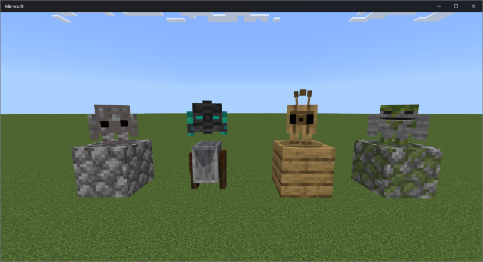

# Minecraft-Legends-Mobs-Bedrock
All the mobs from Minecraft Legends in Minecraft Bedrock Edition.

## Installation
1. Download the [mcaddon](https://github.com/kirbycope/Minecraft-Legends-Mobs-Bedrock/raw/main/Minecraft-Legends-Mobs-Bedrock.mcaddon)
1. Double-click the mcaddon file
1. Load the Resource and Behaviour packs for your world/save

## Releasing
Pushing a tag that starts with `v` (for example `git tag v1.0.0 && git push origin v1.0.0`) runs the Release workflow in `.github/workflows/release.yml`, which builds the add-on and attaches `Minecraft-Legends-Mobs-Bedrock.mcaddon` to a GitHub Release.

To build it locally, run `python tools/build_addon.py`. It writes `build/Minecraft-Legends-Mobs-Bedrock.mcaddon`, which git ignores, and leaves the committed `Minecraft-Legends-Mobs-Bedrock.mcaddon` as it is.
